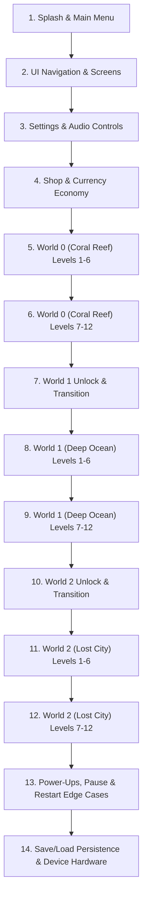

# Ocean Rescuers — Master Manual Testing Plan

**Project:** Ocean Rescuers  
**Engine:** Unity 6  
**Platform:** Android Mobile (Landscape 1920×1080)  
**Target Scope:** World 0 (Coral Reef), World 1 (Deep Ocean), World 2 (Lost City) — 36 Levels  
**Audience:** Unity Developer & QA Tester (Beginner-Friendly Format)

---

## 1. 26-Point Master Game Testing Checklist

This checklist verifies every major feature in Ocean Rescuers across all screens and gameplay flows.

| # | Feature Area | What to Inspect & Verify | Pass / Fail Criteria |
| :---: | :--- | :--- | :--- |
| **01** | **Splash Screen** | Game launches smoothly into `SplashScene`. Animated logo displays without distortion. Transitions automatically to `MainMenuScene` after 2–3 seconds. | Logo scales cleanly in 16:9 and 19.5:9 without clipping. |
| **02** | **Main Menu** | `PlayButton`, `ShopButton`, `SettingsButton`, `CoinPanel`, `GemPanel`, and `EnergyBar` are visible. Pressing `Play` opens World/Level selection. | All buttons have scale press feedback; currencies match saved state. |
| **03** | **World Selection** | Displays 3 world cards: Coral Reef, Deep Ocean, Lost City. Completed worlds show unlocked; locked worlds show gold lock overlay. | Tapping an unlocked card opens its level selection; locked cards prevent entry. |
| **04** | **Level Selection** | 12 level buttons per world (`Level_01` to `Level_12`). Back button returns to World Selection. Header displays current World name. | Buttons display 1–3 stars for completed levels; next playable level is highlighted. |
| **05** | **Level Unlocking** | Completing Level $N$ unlocks Level $N+1$. Completing Level 12 unlocks the next World and its Level 1. | Unlock status persists immediately upon winning without re-locking. |
| **06** | **Gameplay Grid** | `9×5` grid centers on screen. Flanking boundaries (Source on left, Sink on right) are visible and framed properly by camera. | No pipe overlap, no clipping behind TopBar or power-up dock. |
| **07** | **Pipe Rotation** | Tapping a non-locked pipe rotates it 90° clockwise with smooth rotation animation and click audio. Source and Sink pipes remain locked. | Fast multiple taps queue/animate cleanly without spinning off-axis. |
| **08** | **Water Flow** | Connecting pipes to Source immediately illuminates connected pipes with cyan water color. Breaking connection dims disconnected pipes. | BFS flow updates instantaneously; water pulse animation plays on newly connected tiles. |
| **09** | **Source & Sink** | Source (green tint) continuously supplies water. Sink (red/orange tint) accepts incoming water only when pipe alignment connects. | Reaching Sink triggers winning state sequence after water reaches final pipe. |
| **10** | **Move Limits** | Move counter decrements by 1 on each rotation. Counter turns yellow/orange when moves $< 5$. | Moves decrement only on completed pipe rotation; invalid taps do not consume moves. |
| **11** | **Level Failed Condition** | Running out of moves (`Moves == 0`) before water reaches Sink immediately triggers `FailPanel`. | Grid interaction locks; "Out of Moves" message and Retry/Menu buttons appear. |
| **12** | **Level Completion** | Connecting water from Source to Sink successfully triggers `WinPanel`. Audio victory chime plays; board interaction locks. | Stars calculated accurately based on target move count. |
| **13** | **Stars & Rewards** | 3 stars awarded if moves $\le$ 3-star target; 2 stars if slightly above; 1 star on basic solve. Star popping animation plays sequentially. | Best star count is saved permanently to PlayerPrefs. |
| **14** | **Coins & Gems** | Completing levels awards bonus coins/gems. Currency text in TopBar counts up smoothly with rewarding animation. | Currency totals persist across scene transitions. |
| **15** | **Shop** | 4 tabs: Items, Energy, Rewards, Gems. Balance displays accurately. One-time starter pack purchases disable after claim. | Purchases deduct coins/gems correctly and credit energy/power-ups immediately. |
| **16** | **Settings** | Music toggle, SFX toggle, and Reset Progress option. Panel opens with smooth modal scale transition. | Muting music silences menu/gameplay BGM; unmuting resumes playback. |
| **17** | **Sound & Music** | Menu BGM plays in menus; ambient underwater BGM plays in gameplay. Tile rotate SFX, flow chime, and button clicks trigger on touch. | Audio does not crackle or restart abruptly during scene loads. |
| **18** | **Power-ups** | Dock at bottom-right holds power-ups (Hint, Freeze, Wrench, Bubble, Lightning). Tapping an available power-up applies its effect. | Count decrements by 1; empty power-up slots show purchase/locked state. |
| **19** | **Pause Menu** | Tapping Pause opens `PausePanel` and pauses game timer. Options: Resume, Restart, Menu, Settings. | Resuming unfreezes game; grid interactions are blocked while paused. |
| **20** | **Restart** | Tapping Restart (in HUD or Pause menu) resets grid to initial scrambled state and resets moves. | Does not deduct extra energy or lock the grid. |
| **21** | **Home Navigation** | Tapping Menu/Back returns cleanly to Level Selection or Main Menu without memory leaks or missing UI references. | Scene loads without lag or black screen flickering. |
| **22** | **Save & Load** | Player progress, unlocked levels, stars, high scores, coins, gems, and energy persist after closing and restarting game. | Closing game during gameplay does not corrupt save data. |
| **23** | **Energy System** | Playing a level consumes energy (if enabled). Energy regenerates on timer. 0 energy blocks level start with refill dialog. | Timer countdown updates in real time; unlimited energy timer functions if active. |
| **24** | **World Mechanics** | Deep Ocean pressure/sonar/leaks and Lost City runes/doors/bridges trigger only in their respective worlds. | Mechanics never leak into other worlds or appear in World 0. |
| **25** | **UI Responsiveness** | UI scales adaptively to 16:9, 18:9, 19.5:9, 16:10, and 4:3 landscape displays. Buttons remain inside screen bounds. | No text clipping, no overlapping buttons, no off-screen badges. |
| **26** | **Touch Responsiveness**| Touch input responds accurately on mobile screens. No double-tap ghost clicks, no touch offset errors on notched displays. | Tactile button press shrinks and returns smoothly. |

---

## 2. World-Specific Test Plans

### World 0 — Coral Reef (12 Levels)
*Focus: Baseline pipe-routing mechanics, introductory difficulty curve, companion abilities, and standard obstacles.*

- [ ] **Level 1 (Level 1):** Verify simple horizontal routing tutorial. Source (0,0) to Sink (8,0). Verify move limit (16 moves).
- [ ] **Level 2 (Level 2):** Verify elbow turns introducing vertical bends. Verify 20-move limit and 3-star rating target.
- [ ] **Level 3 (Level 3):** Verify T-Junction pipe behavior. Verify unused branch dead-ends do not block main flow.
- [ ] **Level 4 (Level 4):** Verify Cross pipe functionality (straight and orthogonal flow passing simultaneously).
- [ ] **Level 5 (Level 5):** Verify Clownfish companion ability (Pathfinder / move boost) activation.
- [ ] **Level 6 (Level 6):** Verify Turtle companion ability (Shell Smash) clearing breakable rock obstacles.
- [ ] **Level 7 (Level 7):** Verify Octopus companion ability clearing inked hazard obstacles.
- [ ] **Level 8 (Level 8):** Verify Jellyfish companion ability uncharging electric gates.
- [ ] **Level 9 (Level 9):** Verify interactive Water Valves (On/Off tap interaction). Water flow halted until valve is tapped open.
- [ ] **Level 10 (Level 10):** Verify Directional Flow Valves (allowing flow in only one designated direction).
- [ ] **Level 11 (Level 11):** Verify complex multi-branch network combining On/Off valves and companion obstacles.
- [ ] **Level 12 (Level 12):** Coral Reef Grand Finale. Verify multi-valve routing, victory sequence, bonus coin award, and automatic unlock of World 1 (Deep Ocean).

---

### World 1 — Deep Ocean (12 Levels)
*Focus: Hydraulic pressure management, deep-sea obstacles, Sonar scan, and abyssal visibility challenges.*

- [ ] **Pressure HUD & Gauge:** Verify Pressure HUD appears at top-left. Pressure needle/bar moves dynamically based on connected pipe length, bends, and obstructions.
- [ ] **Sonar Scan HUD:** Verify Sonar button appears at bottom-left. Tapping triggers animated sonar wave pulse revealing concealed obstacles for 5 seconds. Verify 8-second cooldown.
- [ ] **Current Booster (Level 2+):** Verify entering current booster tiles accelerates water, venting pipeline pressure and providing flow assistance.
- [ ] **Pressure Release Valve (Level 3+):** Verify tapping pressure release valve opens venting water jet, relieving 30 PSI to avoid pressure warnings.
- [ ] **Pressure Lock Gate (Level 4+):** Verify gate remains locked until pipeline pressure enters safe operating window (e.g. 40–78 PSI).
- [ ] **Oxygen Leak & Pipe Repair (Level 7+):** Verify cracked leak tiles bleed pressure and spray bubbles. Tapping required repair count seals leak.
- [ ] **Abyssal Darkness (Level 8+):** Verify abyssal darkness vignette obscures distant grid tiles until illuminated by flowing water or Sonar Scan.
- [ ] **Tremor Zones (Level 9+):** Verify seismic seabed tremors that occasionally misalign unstable pipe joints unless secured or swiftly routed.
- [ ] **Route Diversion (Level 10+):** Verify hydrothermal hazard diversion vents blocking exit towards hazardous tiles.
- [ ] **Abyssal Sanctuary Beacon (Level 12):** Grand Finale. Verify restoring water flow energizes the ancient deep-sea beacon, triggering triumphant light sequence and unlocking World 2 (Lost City).

---

### World 2 — Lost City (12 Levels)
*Focus: Ancient stone civilization, mystical water runes, unsealing temple doors, and aqueduct bridges.*

- [ ] **Atmosphere & Visuals:** Verify `LostCityBackground.png`, flanking temple pillars, floating golden motes, and mystic cyan runic luminescence activate automatically.
- [ ] **Level 1 (Sunken Promenade):** Verify introduction to ancient stone corridors. Clean routing without ancient machinery.
- [ ] **Level 2 (Rune of the Tides):** Verify **Ancient Rune #0** energizes with golden aquatic flare and chime when water connects.
- [ ] **Level 3 (Sanctuary Portal):** Verify **Temple Door** blocks passage until Rune #0 is energized. Verify stone doors part and unblock BFS flow.
- [ ] **Level 4 (Pedestal of the Sun):** Verify **Ancient Seal** pedestal interaction. Connecting water unlocks linked Temple Door at distance.
- [ ] **Level 5 (Chamber of Relics):** Verify **Energy Relic** resting on altar. Water flow charges relic, triggering `+3 MOVES` floating feedback and adding moves to move limit.
- [ ] **Level 6 (The Aqueduct Chasm):** Verify **Ancient Stone Bridge**. Raised stone span lowers into alignment when key rune is energized, bridging chasm.
- [ ] **Level 7 (Twin Rune Corridor):** Verify dual rune activation. Unsealing Outer Temple Door with Rune #0 and Inner Sanctuary Door with Rune #1.
- [ ] **Level 8 (Sunken Vault):** Verify strategic relic pickup route to gain bonus moves before routing to rune keystone.
- [ ] **Level 9 (Bridge of the Ancients):** Verify lowering stone bridge to cross chasm, accessing ancient seal pedestal to unlock archive door.
- [ ] **Level 10 (Temple of the Ancients):** Verify multi-rune labyrinth requiring coordinated routing through relics and seals.
- [ ] **Level 11 (Celestial Aqueduct):** Verify abyss stone bridge traversal, collecting dual energy relics (+6 moves total), and unsealing sanctuary door.
- [ ] **Level 12 (The Grand Sanctuary):** Grand Climax. Verify multi-stage puzzle combining 2 Runes, Stone Bridge, Energy Relic, Ancient Seal, and Dual Temple Doors. Verify grand victory fanfare.

---

## 3. Standard Test Case Format

Use this tabular format to log individual test executions during manual testing:

| Field | Description | Example Entry |
| :--- | :--- | :--- |
| **Test Case ID** | Unique identifier (`TC-[WORLD]-[FEATURE]-[NUM]`) | `TC-W2-RUNE-001` |
| **World** | Target world (World 0, World 1, World 2) | World 2 (Lost City) |
| **Level** | Target level number | Level 2 (Rune of the Tides) |
| **Feature** | Component or mechanic being verified | Ancient Rune Activation |
| **Pre-Conditions** | Initial state required before test | Level 2 loaded; 24 moves remaining. |
| **Step 1** | First player action | Tap pipe at (1,1) twice to turn flow downward. |
| **Step 2** | Second player action | Rotate pipe at (2,2) to connect flow into Rune at (4,3). |
| **Expected Result** | Expected behavior from design | Water reaches Rune stone; golden flare animates; Rune status changes to energized. |
| **Actual Result** | Observed behavior on device | As expected; golden flare played and chime triggered. |
| **Status** | Test outcome (`PASS`, `FAIL`, `BLOCKED`) | **PASS** |
| **Bug Notes** | Reference to Bug ID if failed | N/A |

---

## 4. Bug Reporting Format & Severity Guidelines

When a defect is discovered during manual testing, log it using this standard structure:

```text
=======================================================================
BUG REPORT
=======================================================================
Bug ID:             BUG-W1-GATE-003
Bug Title:          Pressure Lock Gate remains locked despite optimal PSI
World:              World 1 (Deep Ocean)
Level:              Level 4 (Obsidian Barrier)
Severity:           CRITICAL / HIGH / MEDIUM / LOW
Hardware / Device:  Samsung Galaxy S22 (Android 13, Landscape 19.5:9)

STEPS TO REPRODUCE:
1. Launch game and select Deep Ocean -> Level 4.
2. Route water through initial straight pipes until gauge reads 55 PSI.
3. Observe Pressure Lock Gate at grid (4, 1).

EXPECTED RESULT:
Pressure Lock Gate indicator should turn green and slide open because 55 PSI is within the 40-78 PSI safe activation window.

ACTUAL RESULT:
Gate indicator remains red and status displays 'LOCKED'. Flow cannot cross grid position (4, 1).

SCREENSHOT / VIDEO:
[Attach screenshot or video recording showing HUD gauge and gate status]

STATUS:
OPEN / UNDER INVESTIGATION / RESOLVED / VERIFIED

FIX NOTES:
Check minPressure and maxPressure serialized threshold comparison in PressureLockGate.cs.
```

### Severity Definitions

- **Critical:** Crash, freeze, progression blocker, game-breaking flow deadlock, or save data corruption. Level cannot be completed under any circumstance.
- **High:** Major mechanic malfunctioning (e.g. gate doesn't open on rune energize, moves counter miscalculates, win popup doesn't appear), but game does not crash.
- **Medium:** Minor gameplay or visual glitch (e.g. water particle misaligned by a few pixels, floating text overlaps a pipe, audio effect missing on specific button). Level is still fully playable and winnable.
- **Low:** Cosmetic imperfection, subtle font sizing inconsistency, minor typo in level title, or non-disruptive animation timing delay.

---

## 5. Recommended 14-Stage Testing Order

To catch fundamental bugs early and avoid redundant testing, execute testing in this strict chronological order:



1. **Stage 1 — Splash & Main Menu:** Verify clean boot, logo animation, and currency HUD initialization.
2. **Stage 2 — Navigation:** Verify transitions between Splash, Main Menu, World Selection, and Level Selection.
3. **Stage 3 — Settings & Audio:** Test Sound/Music toggle, volume levels, and menu music continuity.
4. **Stage 4 — Shop & Economy:** Verify purchasing items with coins/gems, energy refill, and purchase protection.
5. **Stage 5 — Coral Reef (Levels 1–6):** Verify basic pipe routing, move decrement, 3-star rating, and Clownfish/Turtle abilities.
6. **Stage 6 — Coral Reef (Levels 7–12):** Verify Octopus, Jellyfish, Valves, Level Complete popup, and Level 12 World Clear reward.
7. **Stage 7 — World 1 Unlocking:** Verify Deep Ocean unlocks automatically after beating Coral Reef Level 12.
8. **Stage 8 — Deep Ocean (Levels 1–6):** Verify Pressure HUD, Current Boosters, Pressure Release Valves, and Pressure Lock Gates.
9. **Stage 9 — Deep Ocean (Levels 7–12):** Verify Sonar Scan HUD, Oxygen Leak repairs, Abyssal Darkness, Tremor Zones, and Beacon Finale.
10. **Stage 10 — World 2 Unlocking:** Verify Lost City unlocks automatically after beating Deep Ocean Level 12.
11. **Stage 11 — Lost City (Levels 1–6):** Verify ancient stone visuals, Ancient Runes, Temple Doors, Ancient Seals, Energy Relics, and Stone Bridges.
12. **Stage 12 — Lost City (Levels 7–12):** Verify multi-rune puzzles, double doors, chasm bridges, and Level 12 Grand Climax.
13. **Stage 13 — Power-Ups & HUD Edge Cases:** Test Undo button, Hint, Freeze timer, Wrench, Restart during mid-flow, and Pause panel resume.
14. **Stage 14 — Persistence & Device Ergonomics:** Close and re-open app to confirm stars, unlocked worlds, and currency are preserved. Test on different landscape phone screens (notches, punch-holes, aspect ratios).
